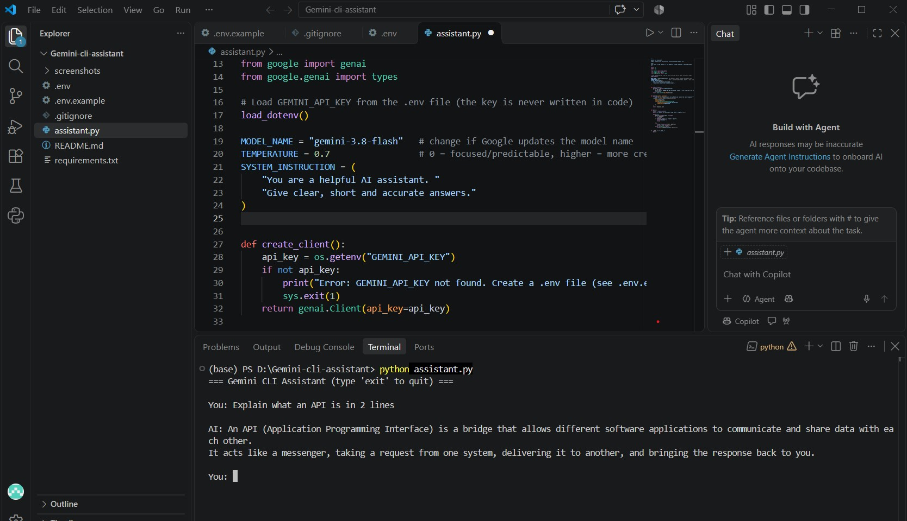
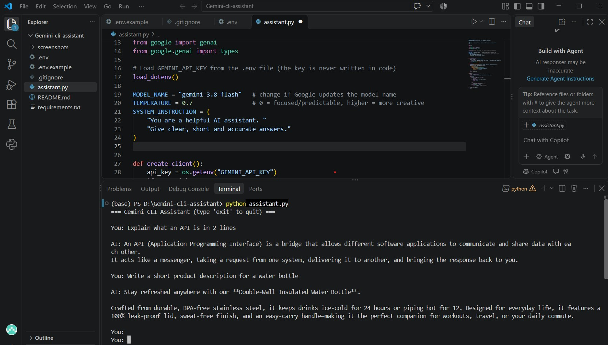

# 💬 Gemini CLI Assistant

**A lightweight command-line AI assistant that sends your questions to the Google Gemini API and prints the answers right in the terminal.**

Type a question, press Enter, and get a short, clear answer. Keep chatting until you type **`exit`**.

---

## 📸 **Screenshots**

| **First API Request** | **Multiple Prompts** |
|---|---|
|  |  |

---

## ✨ **Features**

- **Interactive chat loop:** ask as many questions as you like in one session
- **Gemini-powered answers:** responses generated through the Google Gemini API
- **Custom behavior:** a system instruction keeps answers clear, short and accurate
- **Adjustable creativity:** temperature is configurable in the code
- **Secure API key handling:** the key is loaded from a `.env` file and never written in the code
- **Friendly errors:** shows a helpful message if the API key is missing

---

## 🛠️ **Tech Stack**

| **Category** | **Tools** |
|---|---|
| **Language** | Python |
| **AI Model** | Google Gemini (via the `google-genai` SDK) |
| **Configuration** | python-dotenv |
| **Interface** | Command line (terminal) |

---

## 📁 **Project Structure**

```
Gemini-cli-assistant/
│
├── screenshots/         # Screenshots used in this README
├── assistant.py         # Main program
├── requirements.txt     # Python packages
├── .env.example         # Example of the API key file
├── .gitignore           # Keeps .env (your API key) out of GitHub
└── README.md            # Project documentation
```

---

## 🚀 **Getting Started**

### **1. Clone the repository**

```bash
git clone https://github.com/MariaZafar22/gemini-cli-assistant.git
cd gemini-cli-assistant
```

### **2. Get a free API key**

Create a free key in **Google AI Studio**.

### **3. Install the packages**

```bash
pip install -r requirements.txt
```

### **4. Add your API key**

Copy **`.env.example`** to a new file named **`.env`** and paste your key:

```
GEMINI_API_KEY=your_real_key
```

### **5. Run the assistant**

```bash
python assistant.py
```

You will see:

```
=== Gemini CLI Assistant (type 'exit' to quit) ===

You: Explain what an API is in 2 lines
AI: An API (Application Programming Interface) is a bridge that allows
    different software applications to communicate with each other...
```

---

## 🔍 **How a Request Flows**

1. You type a question in the terminal.
2. The program sends it to the **Gemini API** together with your API key.
3. The model generates a response.
4. The API returns the response to the program.
5. The program prints the answer on screen.

---

## ⚙️ **Settings**

You can change these values at the top of `assistant.py`:

| **Setting** | **Purpose** |
|---|---|
| **`MODEL_NAME`** | The Gemini model to use. Update it if Google changes the model name. |
| **`TEMPERATURE`** | Set to `0.7`. Lower values give focused answers, higher values give more creative ones. |
| **`SYSTEM_INSTRUCTION`** | Tells the model how to behave (clear, short and accurate answers). |

---

## 🔒 **Security**

- The API key is stored in **`.env`** and loaded with `os.getenv`.
- The key is **never written in the code**.
- **`.env`** is listed in `.gitignore`, so it is never uploaded to GitHub.

---

## 📚 **What I Learned**

- How a client application sends a request to an AI API and receives a response
- How to keep secrets out of source code using environment variables
- How temperature and system instructions change the behavior of a language model

## 🔮 **Next Steps**

- Remember earlier messages so the assistant keeps the conversation context
- Stream the answer word by word instead of printing it all at once
- Add commands such as `clear` and `save` to export a chat

---

Built by **Maria Zafar**, who is learning AI by building small, practical projects.
Find more at [GitHub](https://github.com/MariaZafar22) 